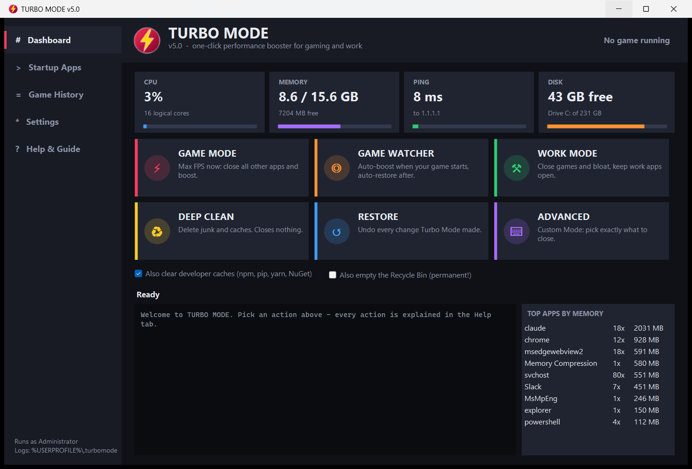
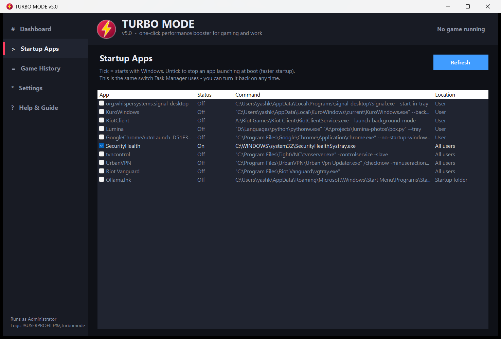
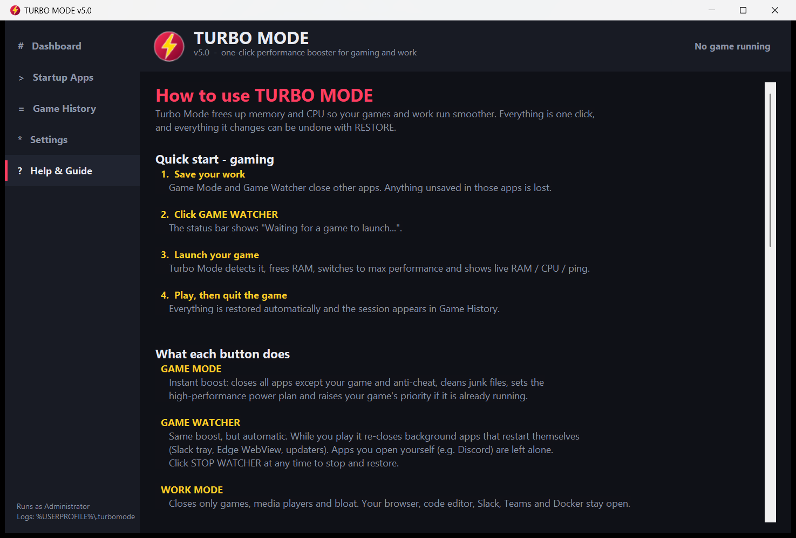

<div align="center">



# ⚡ TURBO MODE v5.1

**One-click performance booster for Windows.** Free up RAM and CPU for games and work, then undo everything with one button. No commands, no setup.

**100% offline · no account · no ads · no data leaves your PC · free & open source**


### [⬇️ Download TurboMode (ZIP)](https://github.com/yogender-ai/TurboMode/archive/refs/heads/main.zip)

</div>

---

## 🚀 Getting started (30 seconds)

1. **[Download the ZIP](https://github.com/yogender-ai/TurboMode/archive/refs/heads/main.zip)** and unzip it anywhere.
2. **Double-click `TurboMode.exe`.**
3. Windows asks *"Do you want to allow this app to make changes?"*. Click **Yes**.
   Turbo Mode needs admin rights to pause services and change the power plan.
4. If you see *"Windows protected your PC"*, click **More info → Run anyway**.
   This appears because the app is unsigned (built from source), not because it is harmful.

Nothing to install: it uses the .NET Framework that already ships with Windows 10/11.

## 🎮 Gaming in 4 steps

| Step | What to do |
|---|---|
| 1 | **Save your work** in other apps (they will be closed) |
| 2 | Click **GAME WATCHER**. The status bar shows *"Waiting for a game to launch…"* |
| 3 | **Launch your game.** Turbo Mode detects it and boosts automatically |
| 4 | **Play, then quit.** Everything is restored on its own, and the session is saved in **Game History** |

> Want Discord to stay open while gaming? **Settings → "Never close these apps"** → add `Discord` → **Save**.

## 🧭 What every button does

| Button | What happens | Closes apps? |
|---|---|---|
| ⚡ **Game Mode** | Instant boost in seconds: closes everything except your game and anti-cheat, frees RAM, max-performance power plan, high game priority. No disk cleanup, so nothing grinds your drive while you play | ✅ all except game |
| ◎ **Game Watcher** | Same boost, but **automatic** when your game starts. Keeps background apps (Slack tray, Edge WebView, updaters) from sneaking back. Apps **you** open mid-game are left alone. Auto-restores when the game closes. | ✅ when game starts |
| ⚒ **Work Mode** | Closes games, media players and bloat. Keeps your browser, IDE, Slack, Teams and Docker | only games and bloat |
| ♻ **Deep Clean** | Deletes temp files, browser and Windows caches, crash dumps and shader cache. Optional: npm/pip/yarn/NuGet caches | ❌ never |
| ↺ **Restore** | Undo every change: restarts paused services, original power plan, network settings | ❌ |
| ⌨ **Advanced** | Opens the classic console with **Custom Mode** (pick exactly which apps to close, save profiles) | your choice |

**Checkboxes under the buttons**
- *Also clear developer caches*: frees gigabytes if you code (packages re-download when needed)
- *Also empty the Recycle Bin*: **off by default**, because emptied files cannot be recovered

## 📑 The other tabs

| Tab | Use it to… |
|---|---|
| **Dashboard** | Live CPU, memory, ping and disk gauges + the apps using the most RAM |
| **Startup Apps** | Untick apps you don't need at boot → Windows starts faster. Tick again to undo (same switch as Task Manager) |
| **Game History** | See every Game Watcher session: game, minutes, RAM freed, lowest free RAM, average/max ping |
| **Settings** | Add your games, apps that must never close, your ping server, and the re-close interval |
| **Help & Guide** | All of these instructions inside the app |

<p align="center">
  
  
</p>

### Adding a game
1. Start the game and open **Task Manager → Details**
2. Find the game's process, e.g. `eldenring.exe`
3. In **Settings → Games to boost**, add `eldenring` (without `.exe`) → **Save**

Already included: Valorant, CS2, Fortnite, Apex, GTA V, Rocket League, League of Legends, Overwatch, Elden Ring, Cyberpunk 2077, Battlefield 2042, **PUBG: Battlegrounds**, and the **BlueStacks** and **Gameloop** emulators (for BGMI, Free Fire and other mobile games on PC).

> Already used an older version? Your saved game list is kept. Add `TslGame`, `HD-Player` or `AndroidEmulatorEn` in **Settings** to get the new ones.

## 🔒 Offline and private

- Works with **no internet**. Nothing is downloaded, uploaded or tracked.
- The only network call is the optional **ping gauge** (to `1.1.1.1` by default, change it in Settings).
- No installer, no background service, no auto-start. Close it and it is gone.
- All settings and logs stay in `%USERPROFILE%\.turbomode\` on your PC.

## 🛡️ Is it safe?

- **Only your own apps are closed.** Windows services, drivers, antivirus and anti-cheat are never touched.
- **Screen recorders are never closed**, so your recording keeps running: Bandicam, OBS, Streamlabs, ShareX, Camtasia, NVIDIA ShadowPlay, AMD ReLive, Xbox Game Bar and more.
- **Always confirms** before closing apps, and lists what's affected.
- **Everything is reversible.** Use **Restore** for services, power plan and network, and re-tick anything in Startup Apps.
- **No slowdown tricks.** It deliberately does *not* delete Prefetch / icon / font caches (that makes Windows slower).
- **Full log** of every action: `%USERPROFILE%\.turbomode\turbomode.log`

## ❓ Troubleshooting

| Problem | Fix |
|---|---|
| "Windows protected your PC" | **More info → Run anyway** (unsigned app) |
| "Anti-cheat blocked priority change" | Normal for Valorant and others. The rest of the boost still works |
| My game isn't detected | Add its process name in **Settings** (see *Adding a game*) |
| Something feels off after boosting | Click **Restore** |
| The app shows an error | Details are saved in `%USERPROFILE%\.turbomode\crash.log` |

---

## 🛠️ For developers

### How it's built
```
TurboMode.exe          Desktop app (C# WinForms). Live gauges, buttons, startup manager, history, settings
   └── runs ──►  TurboMode.ps1   The engine: process control, cleanup, services, power plan, watcher
TurboMode-Console.exe  Classic console menu (same engine, includes Custom Mode)
```
The app streams the engine's output into its log panel. The engine is embedded in both executables, so either one works on its own.

### Command line (engine)
```powershell
TurboMode-Console.exe                      # console menu
TurboMode-Console.exe -Mode Watch          # Game Watcher
TurboMode-Console.exe -Mode Game -Yes      # instant Game Mode, no prompts
TurboMode.exe --watch                      # desktop app, start watching immediately
```
Engine modes: `Menu | Game | Work | Clean | Watch | Monitor | Restore`. Flags: `-Yes`, `-NoDevCaches`, `-EmptyRecycleBin`.

### Build
```powershell
$csc = "$env:WINDIR\Microsoft.NET\Framework64\v4.0.30319\csc.exe"
& $csc -target:winexe -out:TurboMode.exe -win32manifest:app.manifest -win32icon:turbo.ico `
  -resource:TurboMode.ps1,TurboMode.ps1 -r:System.Windows.Forms.dll -r:System.Drawing.dll `
  -r:System.Web.Extensions.dll -r:Microsoft.VisualBasic.dll -r:System.Core.dll TurboModeApp.cs
& $csc -target:exe -out:TurboMode-Console.exe -win32manifest:app.manifest -win32icon:turbo.ico `
  -resource:TurboMode.ps1,TurboMode.ps1 TurboMode.cs
& $csc -target:library -out:KernelMemOptimizer.dll KernelMemOptimizer.cs
```

### Files
| File | Purpose |
|---|---|
| `TurboModeApp.cs` | Desktop app (UI, live stats, startup manager, history, settings, help) |
| `TurboMode.ps1` | Optimization engine |
| `TurboMode.cs` | Console launcher (elevation, standby purge, arg forwarding) |
| `KernelMemOptimizer.cs` | Standby-list purge helper |
| `turbo.ico`, `app.manifest` | Icon (16-256 px) and admin manifest |

User data lives in `%USERPROFILE%\.turbomode\`: `config.json`, `history.csv`, `turbomode.log`.

## 📝 Changelog

**v5.1**
- 🚀 **Game Mode and Work Mode are much faster.** They no longer delete junk files, scan temp-folder sizes, or launch Windows Disk Cleanup. That cleanup kept running hidden in the background for minutes and slowed the disk while you played. Junk cleaning now lives only in **Deep Clean**.
- 🎮 PUBG: Battlegrounds plus BlueStacks / Gameloop (BGMI, Free Fire) added to the default game list
- 🎥 Screen recorders (Bandicam, OBS, ShareX, ShadowPlay, Game Bar and others) are never closed, so recordings survive a boost

**v5.0**
- 🖥️ **New desktop app**: dark UI, live gauges, one-click actions, startup manager, game history, settings and built-in help. High-DPI aware.
- 🎯 **Game Watcher**: auto-boost on launch, guard while playing, auto-restore on exit, 0.5 ms timer resolution, ping tracking, session history
- 🧹 Developer cache cleanup · ⚙️ config file · ⌨️ command-line modes · new icon

**v4.0**
- 🐛 Fixed crash when closing apps, the error flood on every stats screen, and Restore after cleanup
- ✨ Session-safe targeting, kill preview, opt-in Recycle Bin, activity log

## ⚠️ Disclaimer
Closing apps discards their unsaved work, so save first. Provided as-is; use at your own risk.
